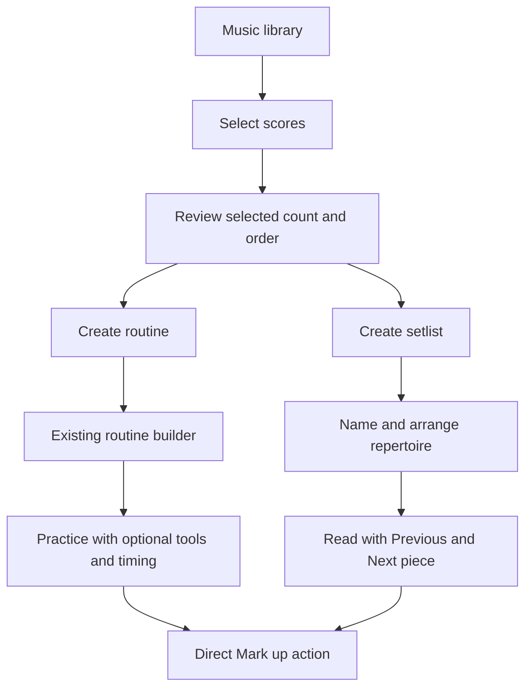

# Music and routines audit bot swarm

This map turns the requested musician-focused audit into a bounded sequence: repair the tuner menu and routine inconsistencies, make score marking and routine assembly easier, then add dedicated setlists for rehearsals and concerts. It records a planning-first audit of the current working tree on October 1, 2026. Application changes have not been implemented. Multitrack is outside this audit.

The subsequent [practice workflow verification](/Users/jameslobb/Documents/SessionMirror/docs/audits/2026-10-01-practice-workflow-verification.md) includes actual phone-size browser sessions, reproduced failures and paid release gates. It supersedes the initial map's untested status for the specific cases it exercised.

## Team and usage limits

The requested lead was interpreted as **GPT-6.1 Sol with high reasoning**. Three actual agents completed bounded, read-only reviews:

| Agent | Model | Responsibility |
| --- | --- | --- |
| Design lead | GPT-6.1 Sol, high | Musician workflow, setlist alternatives, selected design and sequencing |
| Routine critic | GPT-6 Luna, high | Routine defects, preservation of existing workflows, final adversarial review |
| UI critic | GPT-6 Luna, high | Tuner panel geometry, library selection and annotation entry points |

The coordinating chat reconciled findings, checked sources and ran existing utility checks. The model names above are the explicit models requested through the available agent tool, rather than assumed aliases from web documentation.

For implementation, Sol should own design decisions and integration; the two Luna reviewers should test distinct workflows and challenge the result. Only one agent should edit a shared area at a time. Each finding must include evidence, musician impact, a proposed repair and a verification method.

Usage showed **0% used in both reported windows** at the initial and interim checks. The user's floor is **80% remaining**. Treat 85% remaining as the conservative stop threshold for starting further work; check before each new batch and after reviews. Stop dispatching agents at that threshold and report completed work and gaps. The account meter can lag and other chats share the allowance, so this is a monitoring policy, not an enforceable exact cap. No account reset was performed.

## Audit findings

| Priority | Finding and evidence | Proposed response |
| --- | --- | --- |
| First | User reports a clipped tuner Settings menu. The transposition panel uses absolute positioning, a percentage height cap and hidden overflow in [practice-system.css](/Users/jameslobb/Documents/SessionMirror/src/styles/practice-system.css:951), with a tablet bottom override in [tablet.css](/Users/jameslobb/Documents/SessionMirror/src/styles/tablet.css:1817). Source suggests a geometry problem; the affected Settings panel and root cause still need live reproduction. | Reproduce the reported menu first. Fit the panel to available height and safe areas; keep its header and final option reachable, with scrolling owned by the option list. Check the entrance animation and clipped ancestors before selecting a repair. |
| First | The music builder accepts 180-minute values in [MusicRoutineBuilder.tsx](/Users/jameslobb/Documents/SessionMirror/src/components/MusicRoutineBuilder.tsx:275), as does [GuidedRoutineBuilder.tsx](/Users/jameslobb/Documents/SessionMirror/src/components/GuidedRoutineBuilder.tsx:581). Saving normalizes steps through a 60-minute cap in [practiceRoutines.ts](/Users/jameslobb/Documents/SessionMirror/src/utils/practiceRoutines.ts:208). This is a confirmed source inconsistency. | Use one shared supported duration limit. For a fixes-only batch, align inputs with the current 60-minute model and validate entry before saving. Supporting 180 minutes would require extending the model and checking all consumers. Never silently shorten entered practice time. |
| Next | Library multi-select currently offers select-all and deletion only in [MusicLibrary.tsx](/Users/jameslobb/Documents/SessionMirror/src/components/MusicLibrary.tsx:309). Selection also targets the entire library even when a folder or search shows a subset. | Clarify selection scope: Select visible operates on displayed scores; the total selected count includes retained selections across filters. Keep deletion explicit. Add a selected-score handoff to routine creation. |
| Next | Marking is under Page controls, then Read/Mark up tabs in [MusicWidget.tsx](/Users/jameslobb/Documents/SessionMirror/src/components/practiceChart/MusicWidget.tsx:173). Workspace currently lacks a marking action in [PracticeChartLayer.tsx](/Users/jameslobb/Documents/SessionMirror/src/components/PracticeChartLayer.tsx:607). | Add a direct Mark up action on the score's top rail and in Workspace. Open the existing annotation controls and preserve the score's page and zoom. Provide Done marking to restore reading gestures. |
| Next | Routine ordering controls are inside expanded settings and More options in [MusicRoutineBuilder.tsx](/Users/jameslobb/Documents/SessionMirror/src/components/MusicRoutineBuilder.tsx:283). | Put visible up/down controls beside numbered lineup entries. Support touch and keyboard; dragging can remain optional. |

The library-to-routine gap is chiefly an entry-point gap: the existing routine builder already lets musicians choose multiple scores. Preserve that working capability and both score-first and no-score creation paths.

## Musician workflow

The selection bar should show the count and Create routine. Once setlists exist, add Create setlist beside it. Seed the new lineup in library order, show that order before saving and let the musician change it independently. Cancellation or a failed save must preserve the draft or restore the selection.

For routines, keep optional timing, tools and practice progress. For setlists, start with the score reader and quiet practice tools; navigation should not automatically start recording, trigger timed advancement or update daily routine completion.

## Setlist design choice

These are proposed alternatives, not implemented features.

| Approach | Benefit | Tradeoff |
| --- | --- | --- |
| Reuse routines with a setlist presentation | Fastest route using existing ordered steps and launch support | Concert repertoire inherits exercise identity, daily progress and routine limits; separating those behaviors adds complexity |
| Dedicated setlist collection | Independent repertoire order, overlapping lists and deliberate performance navigation | Requires new persistence, list management and reader navigation checks |
| Library folders and ordering | Smallest addition using existing organization | Shared library order and one folder placement per score do not naturally represent overlapping concert programs |

**Selected direction:** dedicated setlists that reuse the existing score reader and, where useful, shared lineup controls. Ship library-to-routine creation first to keep the initial work small. Avoid relabeling an unchanged daily routine as a concert setlist.

A setlist contains a name and ordered entries. Each entry has its own occurrence identity, a reference to the canonical score and an optional musical cue such as movement, measure range or reprise label. The same score may appear in several lists or twice in one list. Each occurrence keeps its own cue and order; score-wide annotations remain shared with the source score.

Removing a list entry must leave the music file, markings and recordings intact. Missing scores should remain identifiable with a replacement action. Creation copies applicable score setup at that moment; later setup edits should not silently change an existing lineup. Do not inherit hands-free recording as a setlist default.

Routines currently have a 12-step limit in [practiceRoutines.ts](/Users/jameslobb/Documents/SessionMirror/src/utils/practiceRoutines.ts:128). Any bulk routine creation must report that limit before saving, rather than silently dropping scores. Setlists need their own supported size policy. Reused exercise IDs also interact with replacement in [routineLibrary.ts](/Users/jameslobb/Documents/SessionMirror/src/utils/routineLibrary.ts:49); distinguish canonical score identity from new lineup occurrences before supporting duplicates or reprises.

## Implementation batches

1. **Repairs:** reproduce and fix tuner clipping; align duration entry and persistence; make filtered selection scope clear. Preserve all current uncommitted work.
2. **Routine usability:** direct score marking, visible ordering controls and selected library scores seeded into the existing routine builder. Preserve the free/no-score path.
3. **Setlists:** independent storage and ordering, repeated pieces with cues, overlapping membership, missing-score repair and explicit piece navigation. Keep existing routines and their histories compatible.
4. **Later recommendations:** searchable score selection inside routine creation, rehearsal-section cues and musician-goal templates. These are workflow hypotheses, not defects or required additions in the first fixes batch.

For each implementation batch: Sol selects and integrates a targeted change; Luna reviewers challenge its musician workflow and edge cases; run affected checks and inspect the actual UI; revise a material weakness once and recheck. Stop when the batch's acceptance criteria pass or the usage threshold prevents more work. Do not run open-ended swarm loops.

## Acceptance criteria for implementation

- The reported tuner Settings panel shows its header and final option on short phone layouts and tablets, respects safe areas and closes/reopens correctly.
- Every duration accepted by either builder survives save/reload unchanged. Unsupported values receive an explicit correction or validation message.
- Filtering and selecting never include hidden scores without clear user intent. The count stays truthful across folders and search.
- Selected scores reach the routine draft once, in the previewed order. An over-limit selection gives an explicit choice before saving.
- Routine creation leaves library order, files, annotations and recordings intact; both score-first and no-score paths still work.
- Mark up is directly reachable, preserves view position and has a clear exit. Reading gestures cannot accidentally draw. Draw, erase, undo and existing save behavior still work.
- Setlists survive restart and preserve independent order, overlapping membership and repeated-score cues. Removing an entry leaves the source score untouched.
- Missing-score entries stay visible and repairable. Setlist navigation does not alter daily practice completion or unexpectedly start tools.

These are proposed checks. They have not passed against a new implementation.

## Validation and remaining gaps

Four existing scripts passed on this working tree:

- `node scripts/verify-practice-routines.mjs`: routine session flow, persistence, recovery and metronome settings.
- `node scripts/verify-routine-music.mjs`: imported music exercises, setup persistence, reuse isolation and tool copying.
- `node scripts/verify-music-library.mjs`: ordering, missing/deleted entries and saved setup isolation.
- `node scripts/verify-routine-program-share.mjs`: linked programs, score placeholders and legacy/malformed files.

These checks validate existing utilities; they do not validate rendered menus or the proposed interactions. Live phone/tablet inspection, the duration regression, annotation interaction tests and all new setlist tests remain unperformed. Use phone portrait and short landscape layouts, plus tablet portrait and landscape. Exercise filters, empty selection, cancellation, save failures, restart, missing scores and full-screen marking.

The final Luna challenge identified a missing setlist detail: repeated scores need different musical cues, not just distinct IDs. The map was revised to add per-occurrence cues while preserving shared score annotations. Another challenge was preserving the existing no-score path; that requirement is now explicit.

**Audit verdict: PASS WITH LIMITATIONS as a planning map.** Source inspection and the four existing checks support the sequencing; rendered visual quality and new behavior remain unverified.

## Reference and copyright question

Assuming the referenced app was forScore, its [setlist documentation](https://forscore.co/documentation/setlists/) describes grouping scores, independent arrangement, navigation and removal without deleting source music. It is a behavior reference for repertoire organization; no visual side-by-side benchmark was performed.

The general idea of organizing music into a setlist is not protected by copyright: the [U.S. Copyright Office](https://www.copyright.gov/what-is-copyright/) distinguishes ideas and methods from protected expression. Implement original code, wording and visuals. This conclusion addresses the general concept, not clearance of a particular implementation or other intellectual-property rights.
